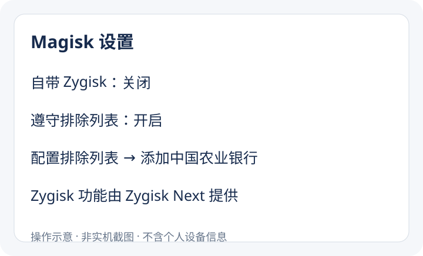

# 农业银行 11.3.1 Root 弹窗处理实测

解决中国农业银行 Android App 启动时的以下提示，同时保留 Root 和其他应用所需的 Zygisk 功能。

> 为保护您的资金安全，中国农业银行不支持root设备上使用。


**本次有效组合：官方农行 11.3.1 + Magisk 31.1 + Zygisk Next 1.5.3 + 强制排除农行 + 匿名内存 + 禁用 IsoService，并在需要时重置已确认的风险记录。**

这是一台设备上的排查记录，不是全机型通用保证。已验证两次冷启动进入首页，第二次观察至少 35 秒，无 Root 弹窗或强退。没有进行登录、账户查询或转账测试，不能据此保证全部银行业务可用。保留应用数据不等于保证服务端登录会话永不过期。

## 1. 实测环境与最终配置

| 项目 | 实测值 |
| --- | --- |
| 农行 | 官方原包 11.3.1，versionCode 119 |
| 包名 | `com.android.bankabc` |
| Magisk | 31.1，31100 |
| Magisk 自带 Zygisk | **关闭** |
| Zygisk Next | **开启**，1.5.3 (880-22a1bf5-release) |
| Next 排除列表策略 | **强制** |
| Next 内存隐藏方式 | **匿名内存** |
| Next 链接器 | **内置**，保留实测默认值，未单独测试其必要性 |
| 农行排除列表 | 主进程和相关子进程均加入 |
| `com.android.bankabc.IsoService` | 仅机主用户下禁用 |
| `XMPushService` | 保持默认，未禁用 |
| 其他 Zygisk 模块 | 已验证模块加载状态，具体模块按个人需要安装 |

**Magisk 设置中的 Zygisk 关闭，并不代表最终没有 Zygisk。这里由 Zygisk Next 提供同类功能，不要同时开启两套实现。**

本次没有安装 Tricky Store 或 FS Enhancer Extreme，也没有修改、重新签名农行 APK。Shamiko 不是本方案已验证有效的必要条件，不需要为照抄本教程另装。

## 2. 安装并启用 Zygisk Next

从 [Magisk 官方发布页](https://github.com/topjohnwu/Magisk/releases) 和 [Zygisk Next 官方发布页](https://github.com/Dr-TSNG/ZygiskNext/releases) 获取对应版本。本文不附带银行 APK、模块二进制或重新打包的安装包。

1. 在 Magisk 的模块页选择“从本地安装”，安装 Zygisk Next ZIP。
2. 进入 Magisk 设置，关闭 **Zygisk**，保留 **遵守排除列表** 开启。
3. 重启手机。等待系统启动完成并解锁，不能只看到 ADB 连上就立即测试。
4. 回到模块页，确认 Next 已启用，并显示 zygote 运行成功。


如果模块页出现 `ZN Magisk Compat`，它是 Next 自动生成的辅助条目，不要手动恢复或启用。



以上为不含个人设备信息的操作示意图，并非实机截图。界面布局以实际安装版本为准。

## 3. 排除农行，并配置 Next

在 Magisk → 设置 → 配置排除列表中找到中国农业银行，展开并勾选相关进程。这里是**加入排除列表**，不是取消勾选。

若界面无法完整列出应用，可以使用下面的终端方式。所有后续命令均在 **Android 手机的 root shell** 中执行。电脑可先执行 `adb shell`，再执行 `su`，不要直接把 Android 命令粘贴进 PowerShell。

```sh
for p in com.android.bankabc \
  com.android.bankabc:CMCoreService com.android.bankabc:appcustom \
  com.android.bankabc:lite1 com.android.bankabc:lite2 \
  com.android.bankabc:lite3 com.android.bankabc:lite4 \
  com.android.bankabc:lite5 com.android.bankabc:push \
  com.android.bankabc:pushservice com.android.bankabc:remote \
  com.android.bankabc:tools
do
  magisk --denylist add com.android.bankabc "$p"
done
magisk --denylist add isolated 'com.android.bankabc:'
magisk --denylist enable
magisk --denylist ls | grep bankabc
```

上面列的是实测配置。若应用升级后进程名变化，应重新核对，不能认为这份列表永久覆盖所有版本。

Next 安装并重启后，在其 WebUI 中设置“排除列表策略 → 强制”“内存隐藏方式 → 匿名内存”，内置链接器保持开启。本次通过下面的等价命令配置，没有使用 WebUI，所以下面提供实际使用的命令。

```sh
/data/adb/modules/zygisksu/bin/zygiskd enforce-denylist enabled
/data/adb/modules/zygisksu/bin/zygiskd memory-type anonymous
/data/adb/modules/zygisksu/bin/zygiskd linker builtin
/data/adb/modules/zygisksu/bin/zygiskd status
```

再次重启并解锁。检查 `status` 应包含：

```text
inject_state:1
enforce_denylist:1
memory_type:1
linker:1
modules_with_issue:0
```

模块列表会因个人安装情况而不同。模块加载状态不代表每一个模块在其他应用中的功能均已验证。

## 4. 禁用农行的 IsoService

本次 11.3.1 的实际组件名是 **`com.android.bankabc.IsoService`**，不要照着其他版本截图猜成 `IsolatedService`。

在手机 root shell 中执行：

```sh
pm disable --user 0 com.android.bankabc/.IsoService
am force-stop --user 0 com.android.bankabc
```

预期返回：

```text
Component {com.android.bankabc/com.android.bankabc.IsoService} new state: disabled
```

此命令只禁用机主用户下的这个组件，不清除应用数据、不卸载应用，也不执行账号退出。`am force-stop` 是结束进程，不是清除数据。

**不需要顺带禁用 XMPushService。** 它在本次有效配置中保持默认。单独禁用它的对照没有解决 Root 弹窗。

## 5. 必要时处理已有风险记录

先按上述配置重新打开 App。如果已经正常，不要额外改私有文件。

本次曾发现 `/data/user/0/com.android.bankabc/envc.push` 保留风险记录。读取并核对检测库后，确认这里使用的是 Base64 包装的 SM4-ECB 记录，不能把网帖里的明文 `r=0` 直接当作本版本的已验证操作。

附带的 [检测记录重置脚本](scripts/reset-risk-record.sh) 只适用于本次核对过的 APK：

```text
SHA-256: cd6ed62253abb06a6ee05e7ce4ba062fcf08e6475c12a7daef4675d65e68b395
```

脚本校验包版本、APK 哈希及已知记录内容，先备份再写入相同格式的 `root=0` 状态。未知 APK、未知记录、符号链接或已有不可变属性均停止处理。只运行 `check` 不会写入文件。

电脑执行：

```sh
adb push scripts/reset-risk-record.sh /data/local/tmp/abc1131-reset.sh
adb shell
su
sh /data/local/tmp/abc1131-reset.sh check
# 核对检查结果后，确实需要重置时才运行：
sh /data/local/tmp/abc1131-reset.sh reset
```

脚本会打印备份目录。请保留该目录，以便按脚本提示恢复。**不执行 `pm clear`，不删除整个数据目录，不使用 `chattr +i` 锁定检测文件。** 最终成功测试中，应用自行删除了该风险记录文件。

## 6. 验证结果

1. 强制停止农行，再从桌面打开。
2. 等待至少 35–40 秒，确认能停留在首页且没有该 Root 弹窗或强退。
3. 再做一次冷启动验证。
4. 检查 Next 仍在运行，以及自己需要的模块仍已加载。

本次最终状态：官方 11.3.1、Root 保留、Next 正在运行、既有 Zygisk 模块已加载、两次冷启动均进入首页。没有操作账户登录或交易。完整对照见 [排查与验证记录](docs/verification.md)。

## 7. 回退与常见问题

**恢复 IsoService：**

```sh
pm default-state --user 0 com.android.bankabc/.IsoService
```

**恢复之前的 Zygisk 实现：**先在 Magisk 中停用或移除 Zygisk Next，再启用 Magisk 自带 Zygisk，并重启。这样会撤销有效配置，农行可能再次拦截。

**重置脚本拒绝执行：**不要删除校验或强行覆盖。相同版本号也可能有不同构建，需要重新核对。

**重新安装、升级后复发：**重新检查组件状态、进程排除和 Next 状态。本教程只记录 11.3.1 的实测，不承诺其他版本或系统相同。

**Zygisk Next 的“隐藏列表”在哪里设置？** 本文使用 Magisk 作为 Root 实现，Next 使用 Magisk 的排除名单。在 **Magisk → 设置 → 配置排除列表** 中添加应用及相关进程，Next 侧保持 **排除列表策略 → 强制**。Next 负责执行排除，Magisk 提供应用名单。若界面只显示少量项目或找不到农行，使用第 3 节的终端命令添加并核对名单，不要因此打开内置 Zygisk。这里的排除名单针对进程注入/挂载处理，不等于从系统中隐藏已安装应用的包名。

**排除列表只剩 WebView Zygote 怎么办？** 某些定制系统会单独限制 Magisk 读取已安装应用。该现象不一定表示排除名单丢失，先用 `magisk --denylist ls` 核对后台名单。本次排查日志明确出现 `OP_GET_INSTALLED_APPS not allowed, return itself!`，只为 Magisk 放开该项权限并重新打开管理器后，列表恢复。

确认系统支持此 AppOp 后，在手机 root shell 中执行：

```sh
cmd appops get com.topjohnwu.magisk GET_INSTALLED_APPS
cmd appops set com.topjohnwu.magisk GET_INSTALLED_APPS allow
am force-stop com.topjohnwu.magisk
am start -n com.topjohnwu.magisk/.ui.MainActivity
```

这只调整 Magisk 的应用列表读取权限，不清除农行数据、不修改排除条目，也不需要重启手机。若返回“未知操作”，不要猜测数字权限编号，改用系统权限管理或第 3 节的终端添加方式。需要撤销时可执行 `cmd appops set com.topjohnwu.magisk GET_INSTALLED_APPS default`。WebView Zygote 是管理器单独添加的条目，不代表手机只安装了一个应用。

**VPN 提示：**属于另一类检测。本次没有验证或解决 VPN 检测，不能把首页能打开当作 VPN 检测也通过。

## 参考

- [Magisk 官方文档](https://topjohnwu.github.io/Magisk/)
- [Zygisk Next 官方仓库](https://github.com/Dr-TSNG/ZygiskNext)
- [排查时参考的网帖](https://zhou2008.cn/2026/07/17/Magisk-%E7%BB%95%E8%BF%87%E4%B8%AD%E5%9B%BD%E5%86%9C%E4%B8%9A%E9%93%B6%E8%A1%8C-Root-%E6%A3%80%E6%B5%8B/)

网帖与本文实测方案不同。本文未使用其全部模块，也未采用明文覆盖及文件锁定操作。
